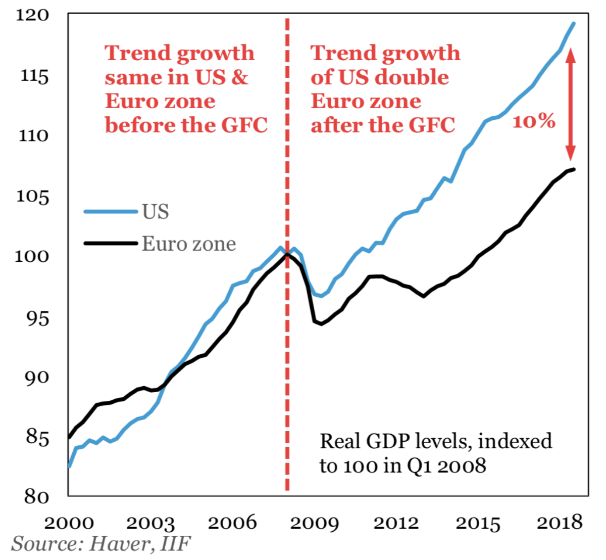
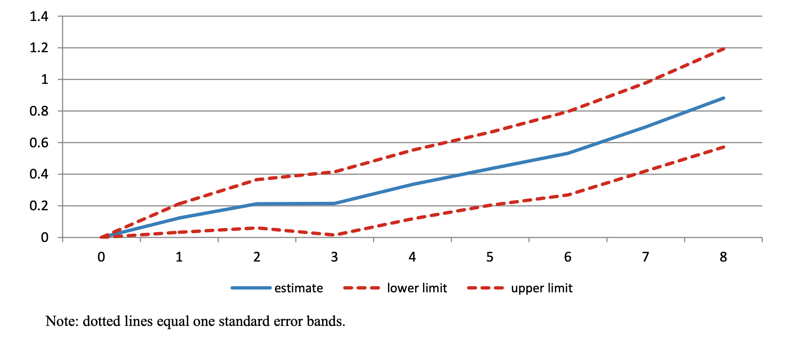
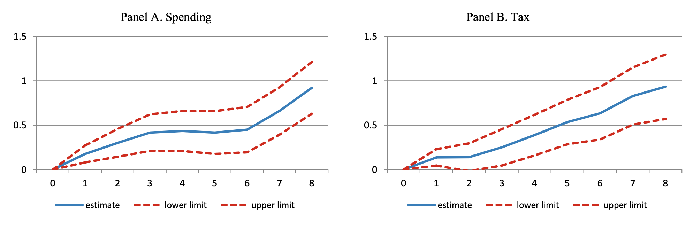
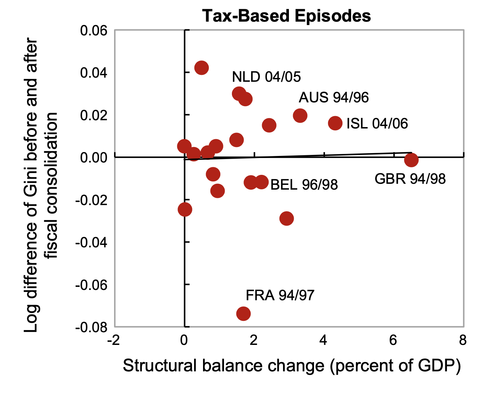
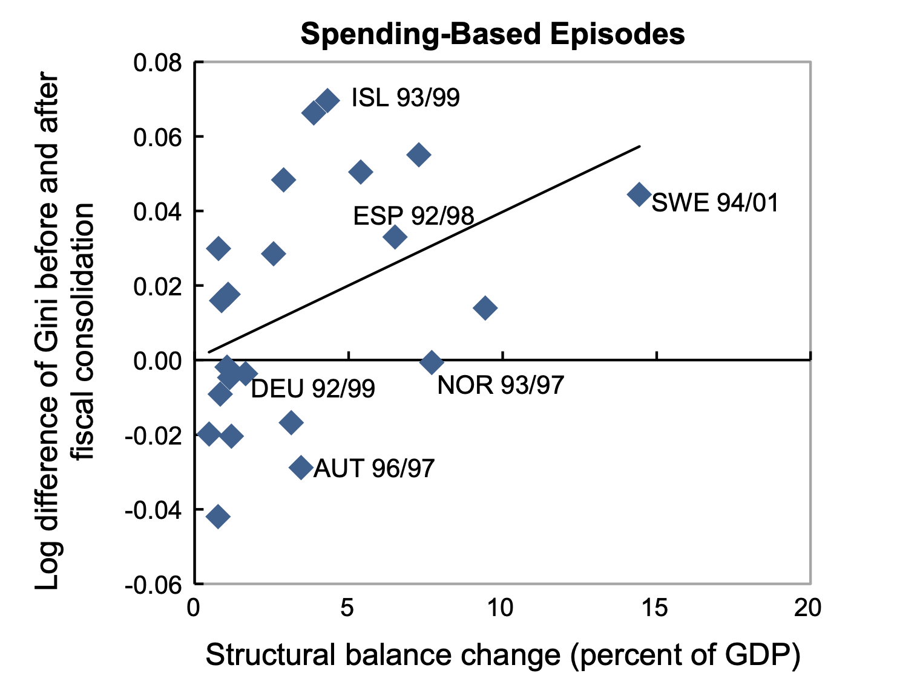
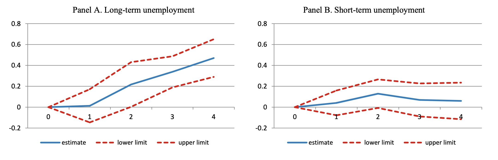
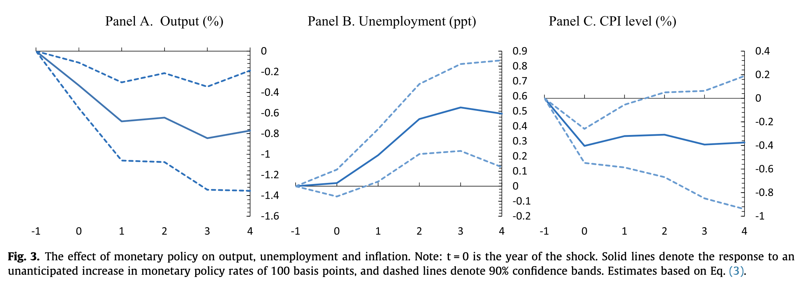
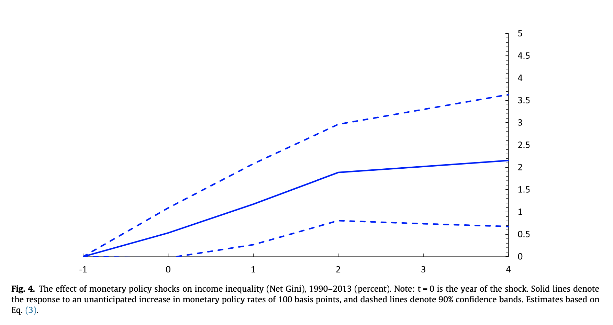

# Fiscal policy

<center>
{width=250}
</center>

::: footer
:::

## Effects of fiscal policy on distribution {.smaller}

Studies typically find that [inequality increases]{.marker-hl} in periods of restrictive fiscal policy:

- @ball:2013: 17 OECD countries from 1978 to 2009
- @agnello:2014: 18 industrialized countries from 1978 to 2009
- @woo:2016: 17 OECD countries from 1980 to 2010
- @heimberger:2020: 17 OECD countries from 1978 to 2013

Methodology: Impulse response functions (IRF) from local projections as proposed by @jorda:2005.

## Fiscal consolidation has dampened growth in Europe

{fig-align="center" height="500px"}


## Fiscal consolidation increases inequality {.smaller}

{fig-align="center"}

::: {.aside}
Source: @ball:2013
:::


## Fiscal consolidation: Spending versus taxes {.smaller}

{fig-align="center"}

::: {.aside}
Source: @ball:2013
:::

## Larger effect for spending-based consolidation {.smaller}

:::: {.columns}
::: {.column width="50%"}
{fig-align="center"}
:::
::: {.column width="50%"}
{fig-align="center"}
:::
::::

::: {.aside}
Source: @woo:2016
:::

## Fiscal consolidation increases (long-term) unemployment {.smaller}

{fig-align="center"}

::: {.aside}
Source: @ball:2013
:::


# Monetary policy

<center>
{width=250}
</center>

::: footer
:::

## Effects of contractionary monetary policy shocks {.medium}

Study by @furceri:2018: 

- (unanticipated) changes in short-term interest rates for a panel of 32 countries from 1990 to 2013 
- contractionary monetary policy shocks reduce output and (mostly) inflation, while increasing unemployment
- contractionary monetary policy shocks increase income inequality, expansionary monetary policy reduces inequality
- effect is asymmetric: tightening of monetary policy raises inequality more than easing lowers it

## Effect of monetary policy on output, unemployment and inflation {.smaller}

{fig-align="center"}

::: {.aside}
Source: @furceri:2018
:::

## Macroeconomic effects of monetary policy {.medium}

- @mirandaagrippino:2021 use high-frequency identified shocks and find that contractionary monetary policy shocks cause persistent declines in output and prices, with effects building up slowly over 1-2 years
- @dokotchatoka:2024 revisit the macroeconomic effects of monetary policy shocks and show that the magnitude and persistence of output and price responses are sensitive to the identification strategy and sample period used
- across studies, contractionary shocks are generally found to reduce output and employment in the short-to-medium run, with inflation responding only gradually (the "price puzzle" in some specifications)


## Effect of monetary policy shocks on inequality {.smaller}

{fig-align="center" height="500px"}

::: {.aside}
Source: @furceri:2018
:::

## Empirical evidence in single countries is ambiguous {.medium}

- @andersen:2023 find for Denmark (1987-2014) that expansionary monetary policy (reduction of rates) leads to more inequality.
- @mumtaz:2017 suggest for the United Kingdom (1969-2012) that contractionary monetary policy resulted in increasing income inequality.
- @coibion:2017 argue that contractionary monetary policy shocks boosted inequality in the United States since 1980.
- @mckay:2023 find that monetary policy has a relatively uniform incidence across households in the United States.

## Unconventional monetary policy and inequality {.medium}

Study by @cercil:2025 on asset purchase programs (quantitative easing):

- examines the distributional effects of unconventional monetary policy, focusing on large-scale asset purchases
- asset purchase programs tend to increase wealth and income inequality, largely through asset price channels that disproportionately benefit asset-holding (wealthier) households
- highlights that unconventional tools can have distributional consequences distinct from those of conventional interest rate policy


## ECB policy and bank profits {.smaller}

Rapid policy rate hikes since 2022 also raised commercial bank profits:

- banks hold large excess reserves at the ECB (built up through years of quantitative easing) which are remunerated at the deposit facility rate
- as the ECB raised the deposit rate from -0.5% to 4% (2022-2023), banks earned sharply higher interest income on these reserves
- meanwhile, banks were slow to pass the higher rates on to retail deposit rates, widening the "arbitrage" margin between what banks earn from the ECB and what they pay savers
- @koukouridis:2025 shows that bank profitability was shaped by central bank reserve remuneration
- this windfall contributed to record bank profits across the euro area and sparked debate about windfall taxes


# All colours are beautiful

<center>
{width=250}
</center>

::: footer
:::

## Colors in R {.medium}

You can assign colors by [names]{.hl .hl-dred} 

- "red", "green", "chocolate", "cadetblue", etc.
- See a complete list of the 657 colors typing [colors()]{.secfont}

. . .

```{r colors}
#| echo: false
head(colors(), 12)
```

. . .

<br> 
Alternatively, you can use [hex color codes]{.hl .hl-dred}

- #F8766D, #00BA38, #619CFF, etc.
- Use color picker to get hex code, e.g. [https://htmlcolorcodes.com](https://htmlcolorcodes.com)


## Color palettes of {RColorBrewer} {.smaller}

::: {.columns}
::: {.column width="33%" .center}
Sequential

[Use to encode numerical information *with order*]{style="font-size:1.3rem;"}
```{r seq}
#| echo: false
#| fig-height: 7
library(RColorBrewer)
display.brewer.all(type = "seq")
```
:::
::: {.column width="33%" .center .fragment}
Diverging

[Use to encode numerical information with *critical midpoint*]{style="font-size:1.3rem;"}
```{r div}
#| echo: false
#| fig-height: 7
display.brewer.all(type = "div")
```
:::
::: {.column width="33%" .center .fragment}
Qualitative

[Use to encode *categorical* information]{style="font-size:1.3rem;"}
```{r qual}
#| echo: false
#| fig-height: 7
display.brewer.all(type = "qual")
```
:::
:::

::: {.aside}
Source: @scherer:2022
:::

## Color blindness {.smaller}

::: {.columns}
::: {.column}
You may check whether the color scale works for people who can distinguish fewer colours than others with [{colorBlindness}]{.secfont}.

```{r cblind}
#| echo: false
#| warning: false
#| fig-height: 4
library(tidyverse)
library(colorBlindness)
colorBlindness::displayAllColors(rainbow(6)) +
	labs(x = NULL, y = NULL) +
	theme_minimal(base_size = 24)
```
:::
::: {.column .fragment}
The [viridis]{.secfont} color scale is discriminable under the most common forms of colour blindness, and reproduces well in greyscale.

```{r viridis}
#| echo: false
#| fig-height: 4
colorBlindness::displayAllColors(viridis::viridis(6)) +
	labs(x = NULL, y = NULL) +
	theme_minimal(base_size = 24)
```
:::
:::

## Fancy palettes {.medium}

::: {.columns}
::: {.column .center}
[[{MetBrewer}]{.secfont}](https://github.com/BlakeRMills/MetBrewer)
```{r met}
#| echo: false
library(MetBrewer)
library(unikn)
unikn::seecol(list(met.brewer("Tiepolo"), met.brewer("Homer1"), met.brewer("Austria"), 
met.brewer("Lakota"), met.brewer("Navajo")),
pal_names = c("Tiepolo","Homer1","Austria","Lakota","Navajo"),
title = "", grid=F)
```
:::
::: {.column .center}
[[{wesanderson}]{.secfont}](https://github.com/karthik/wesanderson)
```{r wes}
#| echo: false
library(wesanderson)
unikn::seecol(list(wes_palette("Zissou1"), wes_palette("Darjeeling1"), 
wes_palette("Cavalcanti1"), wes_palette("FantasticFox1"), wes_palette("Moonrise3")),
pal_names = c("Zissou1","Darjeeling1","Cavalcanti1","FantasticFox1","Moonrise3"),
title = "", grid=F)
```
:::
:::


## Color scales in {ggplot} {.smaller}

::: {.center .secfont style="font-size:2.5rem;"}
scale_color_\* <br> scale_fill_\*
:::

::: {.columns}
::: {.column .center}
Continuous: 

- [ continuous(type)]{.secfont}
- [distiller(palette)]{.secfont}
- [gradient(high, low)]{.secfont}
- [gradient2(high, mid, low)]{.secfont}
- [gradientn(colours)]{.secfont}
- [viridis_c(option)]{.secfont}
:::
::: {.column .center}
Discrete:

- [manual(values)]{.secfont}
- [brewer(palette)]{.secfont}
- [grey(start, end)]{.secfont}
- [viridis_d(option)]{.secfont}
:::
:::


## Bibliography {.bibstyle}

:::footer
:::